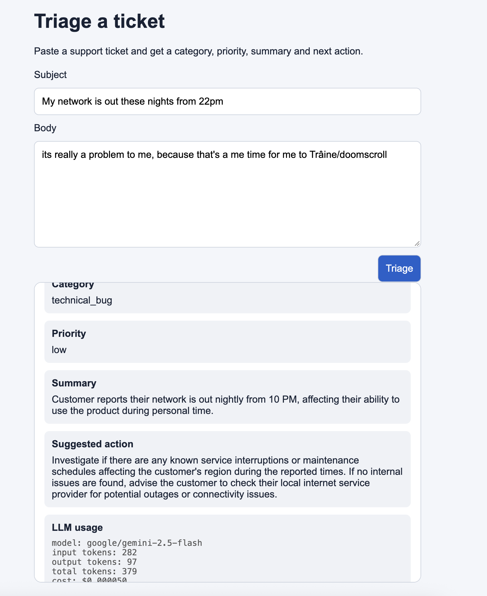
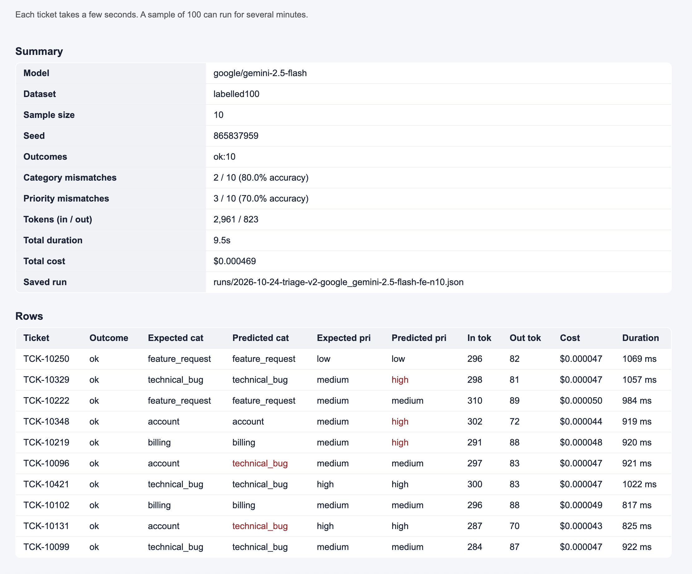

# Support ticket triage app

A small Next.js app that classifies incoming support tickets with an LLM. A
support agent pastes a ticket; the server sends it to an OpenAI-compatible
chat-completions endpoint and returns a validated object with a category, a
priority, a concise summary, and one suggested next action.

Built for the BCS S5 — EPITA — AI Systems Integration & Operations course.

## Pages

- `/` — mock chat (keeps conversation history client-side)
- `/triage` — triage form: subject + body in, 4 validated fields + token/cost usage out
- `/smoke` — FE-driven smoke test runner (pick dataset + sample size, see predicted vs expected and mismatch counts)
- `/admin` — call history, tokens, cost per model/prompt, and one row per saved smoke run

## Screenshots

**Triage result with token/cost usage (F1 + F2):**



**FE smoke runner — summary and per-row predicted vs expected (F3 + F4):**



## Run locally

Requires Node.js 20.9 or newer.

```sh
cp .env.example .env.local            # then fill in your provider details
npm install
npm run dev
```

Then open http://localhost:3033.

### Environment variables

`.env.local` (gitignored):

```
LLM_BASE_URL=https://openrouter.ai/api/v1
LLM_API_KEY=sk-or-v1-...
LLM_MODEL=google/gemini-2.5-flash
LLM_STRUCTURED_OUTPUT=json_schema      # or `prompt`
```

Any provider that speaks the OpenAI chat-completions API works
(OpenRouter, OpenAI, your school server, …). The key never reaches the browser.

## Homework features (F1–F5)

| # | Feature | Where it lives |
|---|---------|----------------|
| F1 | Structured triage flow with JSON schema and Zod validation. Invalid payloads surface a short error code on the FE, never a stack trace. | `lib/schema.ts`, `lib/llm.ts`, `app/api/triage/route.ts`, `app/triage/page.tsx` |
| F2 | Token usage display on each triage result (input, output and total tokens, plus USD cost). | `app/api/triage/route.ts` (returns `_meta`), `app/triage/page.tsx` (renders the usage box) |
| F3 | FE-driven smoke test runner. User picks the dataset (labelled 100 or unlabelled 500) and a random sample size. For the labelled set, every row shows predicted vs expected category/priority and the summary counts mismatches. | `app/smoke/page.tsx`, `app/api/smoke/route.ts` |
| F4 | Smoke-test logging + `/admin`. Every labelled-dataset run is written to `runs/<date>-<prompt-ver>-<model>-fe-n<N>.json` with accuracy, outcome counts, latency, cost and the LLM model. `/admin` lists every logged run. | `app/api/smoke/route.ts`, `lib/runs.ts`, `app/admin/page.tsx` |
| F5 (optional) | Model switcher in the FE. Not implemented — configuration is instead swapped at the env-file level (see below), and `/admin` already shows side-by-side runs for the different models. | — |

## Project layout

```
app/
  page.tsx                 chat page (conversation history held client-side)
  layout.tsx               shared layout with top nav
  triage/page.tsx          triage form + four-field result view + token/cost box
  smoke/page.tsx           FE smoke runner (dataset picker, sample size, result table)
  admin/page.tsx           server component: reads logs/llm-calls.jsonl + runs/
  api/
    chat/route.ts          POST { messages } → { answer }
    triage/route.ts        POST { ticket } → validated TriageResult + _meta
    smoke/route.ts         POST { dataset, sample_size } → rows + summary; writes runs/
lib/
  llm.ts                   shared OpenAI client, runTriage(ticket)
  prompt.ts                PROMPT_VERSION + SYSTEM_MESSAGE + buildUserMessage
  schema.ts                Zod TriageSchema + generated JSON schema
  errors.ts                LlmInvalidOutputError
  logging.ts               logCall / readLog for logs/llm-calls.jsonl
  pricing.ts               model slug → USD per 1M tokens
  config.ts                providerFromBaseUrl
  runs.ts                  listRuns() reads runs/*.json for the admin page
scripts/
  smoke.ts                 CLI runner (also writes to runs/), useful for long full-dataset runs
data/                      500 unlabelled + 100 labelled sample tickets
logs/                      llm-calls.jsonl (gitignored)
runs/                      smoke-test outputs (gitignored)
EXPERIMENTS.md             experiment log (one row per change)
```

## Smoke test

Two ways:

**From the FE** (`/smoke`): pick dataset + sample size, click Run.
Each ticket typically takes a few seconds; a sample of 100 can take several minutes.

**From the CLI**:

```sh
npm run smoke -- --limit 5     # start small to sanity-check wiring
npm run smoke                   # full labelled 100
```

Both save a file to `runs/`, which `/admin` picks up automatically.

## Quality checklist

### Architecture
- [x] One LLM module (`lib/llm.ts`); the SDK is only imported there and in the
      route-level error-mapping. No SDK imports in client components or pages.
- [x] Prompts live in `lib/prompt.ts` with a `PROMPT_VERSION` constant
      (currently `"triage-v2"`).
- [x] All provider settings come from environment configuration
      (`LLM_BASE_URL`, `LLM_API_KEY`, `LLM_MODEL`, `LLM_STRUCTURED_OUTPUT`).
      Prices live in `lib/pricing.ts`. Nothing hard-coded in route handlers.

### Error handling
- [x] Every failure in `/api/triage` maps to one HTTP status and one safe
      error code, via `classify()`:

      | Failure                              | Status | Outcome                 |
      |--------------------------------------|-------:|-------------------------|
      | Invalid JSON / schema mismatch       |    502 | `invalid_model_output`  |
      | Provider 429                         |    429 | `rate_limited`          |
      | Provider 5xx / connection error      |    502 | `triage_unavailable`    |
      | Timeout                              |    504 | `triage_timeout`        |
      | 400 / 401 / 403 / 404 / other        |    500 | `internal_error`        |

- [x] Timeout and retries set explicitly on the OpenAI client
      (`timeout: 30_000`, `maxRetries: 2`).
- [x] No stack trace or provider message reaches the browser — only the short
      error code, which the client maps to a friendly message.

### Security
- [x] The API key is used only server-side. The browser Network tab shows no
      `Authorization` header, no key in request/response bodies.
- [x] `.env.local` is gitignored (`.gitignore` has `.env*` with an
      `.env.example` exception). `git check-ignore -v .env.local` confirms.
- [x] The API rejects over-long input at `MAX_TICKET_CHARS = 5000` with a 400,
      before any provider call.
- [x] Logs contain no API key and no full ticket text — only
      model/provider/tokens/duration/outcome. See `lib/logging.ts`.
- [x] `buildUserMessage` strips any `<ticket>` / `</ticket>` tags from
      customer input, closing the TCK-10087 "close the tag and inject new
      instructions" vector. Role separation is still just a convention; the
      Zod schema at the exit is the hard guarantee that output stays in shape.

## Switch and compare providers / models

The code reads provider settings only from env vars, so switching is a file
swap. Templates are provided for two configurations; copy and fill in the key:

```sh
cp .env.openrouter-mini.example   .env.openrouter-mini    # then edit the key
cp .env.openrouter-haiku.example  .env.openrouter-haiku   # then edit the key
```

To make one active:

```sh
cp .env.openrouter-mini .env.local
# restart `npm run dev` so Next.js picks up the new env
npm run smoke                      # or run from /smoke in the browser
```

Each run writes `runs/<date>-<prompt-version>-<model>*.json`. The admin page
reads that directory and shows one row per run under *Smoke-test runs*:
accuracy, outcome counts, tokens, cost, duration.

### Comparison table (labelled 100 dev set, prompt `triage-v2`, runs 2026-10-24)

| Config | Model | Category acc | Priority acc | Avg latency | Cost / 100 tickets | Notes |
|--------|-------|--------------|--------------|-------------|--------------------|-------|
| A      | `google/gemini-2.5-flash`      | 88.9% (88 / 99 ok) | 68.7% (68 / 99 ok) | 0.96 s/ticket | $0.005264 | 1 `invalid_model_output` / 100; was the original baseline for `/triage` |
| B      | `google/gemini-2.5-flash-lite` | **94.0% (94 / 100 ok)** | **70.0% (70 / 100 ok)** | **0.75 s/ticket** | $0.007289 | 0 errors / 100; higher accuracy and lower latency, slightly higher $ per 100 tickets |

### Three concrete differences

1. **Robustness of the structured output.** Flash returned one `invalid_model_output` (1 / 100) on this run; flash-lite returned 100 / 100 valid JSON. In practice flash-lite was more disciplined about the schema on this dataset.
2. **Latency.** Flash-lite is faster per ticket (0.75 s vs 0.96 s). The runs are sequential, so this is a direct wall-clock saving on the smoke test.
3. **Cost vs accuracy trade-off.** Flash-lite was cheaper per 1M input tokens on Google's own pricing but more expensive on output; the output-heavy triage call made the end-to-end run slightly costlier, but accuracy went up on both labels — net favourable for most of the dev set.

## Decision Model (Activity 10 — "On the edge")

**Chosen DM:** `google/gemini-2.5-flash-lite` — a smaller Google model, free-tier accessible via OpenRouter and the Google AI Studio API.

**What it can / cannot do here:**
- *Can* — honour the strict JSON schema (0 invalid outputs on the dev set), classify most tickets correctly, and do it faster per ticket than the full flash model.
- *Cannot (reliably)* — perfectly resolve priority on ambiguous or multilingual tickets. Priority accuracy is 70% vs category 94% — the model still defaults to `medium` on hard cases.

**Run file:** `runs/2026-10-24-triage-v2-google_gemini-2.5-flash-lite.json`

**One-sentence verdict:** *On this dev set the lite variant was both faster and more accurate than the full flash model, at a small extra cost per 100 tickets — a reasonable default for `/triage`, with flash kept as the fallback when lite's rate limit is reached.*

## Sample data

The `data/` folder contains two support-ticket datasets:

- **500 unlabelled tickets** in
  [`support_tickets_500.csv`](./data/support_tickets_500.csv) and
  [`support_tickets_500.json`](./data/support_tickets_500.json), for exploring
  and developing the triage workflow. A few are deliberately adversarial
  (e.g. TCK-10087 closes `</ticket>` and injects pirate instructions).
- **100 labelled tickets** in
  [`support_tickets_100_labelled.csv`](./data/support_tickets_100_labelled.csv)
  and
  [`support_tickets_100_labelled.json`](./data/support_tickets_100_labelled.json).
  These include triage annotations (category, priority, needs-human-review)
  and `tags` such as `multilingual`, `adversarial|prompt_injection`,
  `ambiguous`, `long`.

## Checks

```sh
npm run typecheck
npm run build
```
